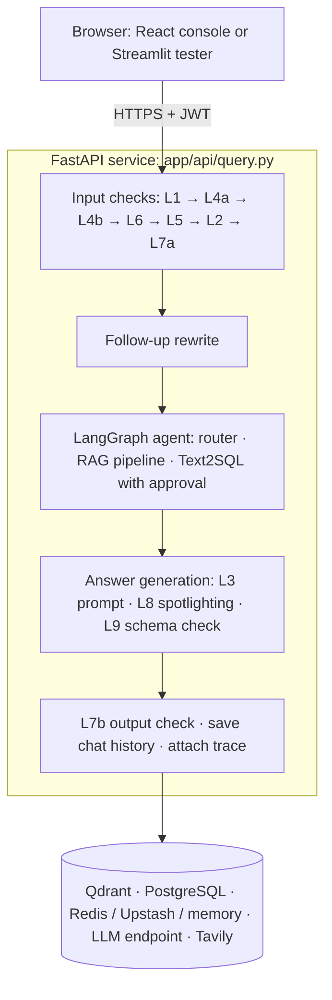
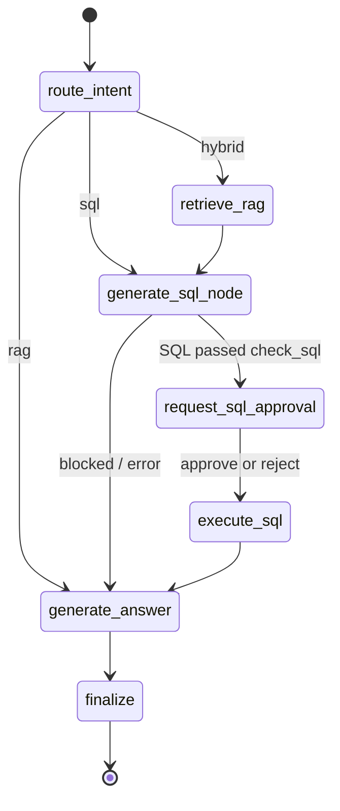
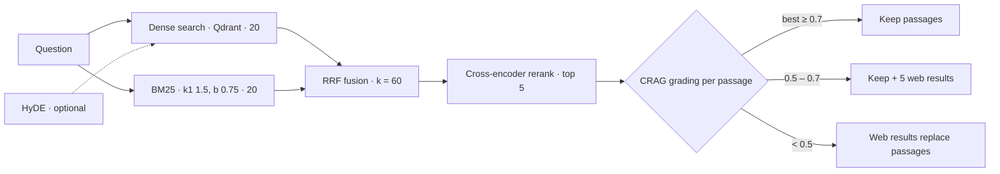

<div align="center">

# SRE-Copilot

### A production-grade RAG and Text2SQL system for Kubernetes operations, using hybrid retrieval, self-correction and LangGraph orchestration

*(shown as **K8s Ops Copilot** in the console)*

[](https://www.python.org/downloads/)
[](https://fastapi.tiangolo.com)
[](https://langchain.com/langgraph)
[](https://qdrant.tech)
[](https://www.postgresql.org)
[](https://react.dev)

**B.Tech Project · Department of Information Technology · Delhi Technological University**

</div>

---

## Project details

| | |
|---|---|
| **Project title** | SRE-Copilot: A Production-Grade RAG and Text2SQL System for Kubernetes Operations Using Hybrid Retrieval, Self-Correction and LangGraph Orchestration |
| **Course** | IT401 B.Tech Project-I (minor project component), Semester VII, Bachelor of Technology in Information Technology |
| **Department** | Department of Information Technology |
| **University** | Delhi Technological University (Formerly Delhi College of Engineering), Bawana Road, Delhi-110042 |
| **Group** | 163 |
| **Supervisor** | **Dr. Varsha Sisaudia**, Assistant Professor, Department of Information Technology, DTU |

### Authors

| Name | Roll No. |
|---|---|
| **Sumay Mittal** | 23/IT/163 |
| **Yash Kalra** | 23/IT/178 |
| **Aditya Ahlawat** | 23/IT/194 |

---

## What it does

Site-reliability and platform engineers ask two kinds of questions during an incident. Some are about
procedure (*"How do I debug a CrashLoopBackOff?"*), and the answer lives in documentation and runbooks.
Others are about their own data (*"Which 5 clusters had the most P1 incidents?"*), and the answer lives in a
database. SRE-Copilot answers both from one chat box:

- **Documentation questions** go through a retrieval-augmented generation (RAG) pipeline: hybrid dense + BM25
  search fused with Reciprocal Rank Fusion, an optional cross-encoder reranker and HyDE, per-passage Corrective
  RAG (CRAG) grading with a web-search fallback, and an optional Self-RAG review of the draft answer.
- **Data questions** are turned into PostgreSQL by the model, checked with `EXPLAIN`, screened by a rule-based
  SQL guard, and run **only after a person approves the query**, in a read-only transaction.
- **Hybrid questions** use both paths and merge the results into one answer.

A LangGraph state machine joins the paths and stores its checkpoints in Postgres, so a query waiting for
approval survives a restart. Every request passes through nine security layers, five cache tiers keep repeat
work cheap, and every answer carries a step-by-step trace that the React console shows live.

The assistant never connects to a live cluster and cannot run `kubectl`: all answers come from the indexed
documents and a synthetic operations database.

---

## Architecture



### LangGraph workflow (`app/core/graph.py`)



`request_sql_approval` calls `interrupt()`: the run pauses, the checkpoint is written to Postgres, and the API
returns a `pending_sql` block. `POST /query/sql/execute` resumes the same thread after checking that the caller
owns the query (404 otherwise) and that it has not been answered already (409).

### Retrieval pipeline



Passages graded below 0.5 never reach the answer prompt. With no usable passage and no web key, the system
returns a fixed "not found in the knowledge base" message instead of guessing.

---

## Security layers

The layer numbers are labels; the checks run cheapest first, so malformed or unauthenticated requests are
rejected before any model is called.

| Order | Layer | Module | What it does | On failure |
|---|---|---|---|---|
| 1 | **L1** | `app/models.py` | Pydantic limits (question 1–2,000 chars, `top_k` 1–50) and regex families for known injection phrases | 422 |
| 2 | **L4a** | `app/middleware/auth.py` | JWT (HMAC-SHA256) on every protected call; admin routes need `is_admin` | 401 / 403 |
| 3 | **L4b** | `app/middleware/rate_limiter.py` | Sliding window, 20 questions per user per 60 s | 429 |
| 4 | **L6** | `app/security/token_budget.py` | 100,000 tokens per user per UTC day | 429 |
| 5 | **L5** | `app/security/input_restructuring.py` | Counts tokens with tiktoken and trims over-long input | never blocks |
| 6 | **L2** | `app/security/input_guard.py` | Heuristic rules (also on base64-decoded text), then llm-guard PromptInjection, Toxicity, BanTopics | 400 |
| 7 | **L7a** | `app/security/content_moderation.py` | Moderation and PII redaction (email, phone, card, SSN, IP, API keys) | 400 |
| 8 | **L3** | `app/security/system_prompt.py` | Hardened system prompt: user text and documents are data, not instructions | behavioural |
| 9 | **L8** | `app/security/spotlighting.py` | Fences retrieved chunks as untrusted data and escapes closing tags | behavioural |
| 10 | **L9** | `app/security/output_validator.py` | Validates the model's JSON against the schema, up to 2 retries | plain-text fallback |
| 11 | **L7b** | `app/security/content_moderation.py` | Same moderation and PII redaction on the final answer | 500 |

Text2SQL has its own guard, `check_sql()` in `app/services/sql_service.py`: one `SELECT`/`WITH` statement only,
no comments, 25 forbidden keywords and functions, no data-modifying CTEs, and only the seven operational tables
(`users`, `pg_*` and `information_schema` are blocked). Execution re-checks the SQL and runs it read-only with a
5-second statement timeout and a 200-row cap.

---

## Cache tiers

Cache-aside on Upstash, plain Redis, or an in-memory dictionary, whichever is configured. Keys are SHA-256
hashes prefixed with the tier name.

| Tier | Key is a hash of | TTL |
|---|---|---|
| `embedding` | the exact text with its model prefix | 7 days |
| `intent` | the trimmed, lower-cased question | 24 hours |
| `sql_gen` | the question | 24 hours |
| `sql_result` | the normalised SQL | 15 minutes |
| `rag_answer` | question + search mode + every technique flag + `top_k` | 1 hour |

Uploaded files are also de-duplicated by SHA-256 (local disk or S3) before any parsing or embedding.

---

## Data

- **Signal documents** (`seed/docs/true_data/`): 56 files, mostly Kubernetes documentation (CC BY 4.0) in mixed
  formats (PDF, DOCX, HTML, Markdown, text), plus three internal runbooks written for the project. One wiki page
  carries a planted indirect prompt injection to test the defences.
- **Noise documents**: research papers and books from `github.com/tpn/pdfs`, fetched with a fixed seed. The
  default fetches 60 PDFs; `NOISE_COUNT=950` gives the full ~95% noise design.
- **Operations database**: seven synthetic tables created by `seed/migrations/003_seed_k8s_ops.sql`.

| Table | Rows |
|---|---|
| `clusters` | 50 |
| `nodes` | 5,000 |
| `deployments` | 10,000 |
| `pods` | 50,000 |
| `incidents` | 2,000 |
| `alerts` | 100,000 |
| `oncall_logs` | 20,000 |

- **Evaluation set**: 40 hand-written golden questions in `eval/seed_questions.yaml` (documentation, SQL,
  hybrid and out-of-scope questions).

---

## Quick start

### Option A: fully local, no Docker and no API keys

```bash
# Tools: Python 3.12, uv, Postgres binaries, Ollama, Node 20+
brew install uv postgresql@17 ollama node
ollama pull qwen2.5:3b && ollama pull nomic-embed-text

make install                 # Python dependencies
cp .env.example .env         # then switch on the local options:
#   the "Ollama" block, QDRANT_PATH, the :5434 DATABASE_URL, and
#   EMBEDDING_QUERY_PREFIX="search_query: "  EMBEDDING_DOCUMENT_PREFIX="search_document: "

make local-up                # private Postgres on :5434
make seed-data               # Kubernetes docs, runbooks and the noise sample
make seed                    # migrations, demo users, document ingestion
make api                     # http://localhost:8000  (API docs at /docs)
make ui                      # http://localhost:5173
```

Embedded Qdrant allows one process at a time, so stop the API before re-running `make seed`.

### Option B: Docker and an OpenAI-compatible endpoint

```bash
cp .env.example .env         # set OPENAI_API_KEY (optionally OPENAI_BASE_URL, Upstash and Tavily keys)
docker compose up -d         # Postgres 16 and Qdrant
make seed-data && make seed
make api
```

### Demo accounts

| Username | Password | Can |
|---|---|---|
| `agent@demo.local` | `agent123` | ask questions, approve their own SQL |
| `admin@demo.local` | `admin123` | also upload documents, view and clear caches |

These are the local defaults. The hosted copy seeds its own passwords from
`DEMO_AGENT_PASSWORD` and `DEMO_ADMIN_PASSWORD`.

### Hosted deployment (free tiers)

| Part | Runs on |
|---|---|
| API and console, one HTTPS URL | [Modal](https://modal.com), image from [`deploy/Dockerfile`](deploy/Dockerfile) with the models baked in |
| LLM | Gemini 3.5 Flash-Lite through its OpenAI-compatible endpoint |
| Embeddings | nomic-embed-text-v1.5 in-process via fastembed (`EMBEDDING_BACKEND=fastembed`) |
| Vector store | embedded Qdrant on the Modal volume `sre-copilot-data` |
| Postgres | [Neon](https://neon.com) (direct, non-pooled connection, for the LangGraph checkpointer) |

```bash
# 1. Database: tables, demo data and demo users
DATABASE_URL=<neon-direct-url> DEMO_AGENT_PASSWORD=... DEMO_ADMIN_PASSWORD=... \
  uv run python scripts/seed_db.py --no-ingest
# 2. Vector store: re-embed the local collection with fastembed, then upload it
EMBEDDING_BACKEND=fastembed EMBEDDING_MODEL=nomic-ai/nomic-embed-text-v1.5 \
  uv run python scripts/reembed_collection.py --src-path .localdev/qdrant \
  --src k8s_docs_nomic_v2 --dst-path deploy/qdrant --dst k8s_docs
modal volume put sre-copilot-data deploy/qdrant /qdrant
# 3. Config and keys go in the Modal secret "sre-copilot-env", then:
modal deploy deploy/modal_app.py
```

[`deploy/modal_app.py`](deploy/modal_app.py) runs one container (embedded Qdrant
allows one process). Two scheduled jobs keep it warm from 09:00 to 21:00 IST and
let it scale to zero otherwise, which keeps it inside Modal's free monthly credits.

---

## Demo console (`frontend/`)

React 19, TypeScript and Vite with shadcn/ui, Tailwind CSS, Motion and Bklit charts.

- **Landing page**: replays a recorded request through the pipeline, shows the retrieval funnel, and includes a
  small SQL-approval demo and the beginner's guide (`docs/SRE-Copilot-Beginners-Guide.pdf`).
- **Ask**: chat with saved conversations and follow-up questions, live stage-by-stage progress over
  Server-Sent Events, SQL approval cards, result tables, blocked-attack cards, and switches for each technique.
- **How it works**: every stage explained, with a glossary.
- **Knowledge**: signal and noise counts, the document list, and admin upload.
- **System**: service health, cache hit/miss per tier, and the remaining token budget.

`make ui-build` builds it and the API serves it at `http://localhost:8000/ui/`. A Streamlit tester is also
available with `make streamlit`.

---

## API

| Method | Path | Auth | Description |
|---|---|---|---|
| `POST` | `/auth/register` | public, IP rate-limited | Create an account |
| `POST` | `/auth/login` | public, IP rate-limited | Get a JWT |
| `GET` | `/auth/me` | JWT | Current user and remaining token budget |
| `POST` | `/query` | JWT | Ask a question (rag, sql or hybrid) |
| `POST` | `/query/stream` | JWT | Same, streamed as Server-Sent Events |
| `POST` | `/query/sql/execute` | JWT | Approve or reject pending SQL |
| `GET` | `/conversations` | JWT | Saved chats |
| `GET` / `PATCH` / `DELETE` | `/conversations/{id}` | JWT | Open, rename or delete a chat |
| `POST` | `/documents/upload` | admin | Upload and index a PDF, DOCX, HTML, Markdown or text file |
| `GET` | `/documents` | JWT | Indexed documents with chunk counts |
| `GET` | `/admin/health` | public | Dependency health |
| `GET` | `/admin/cache/stats` | admin | Per-tier cache counters |
| `POST` | `/admin/cache/clear` | admin | Clear the cache tiers |

Per-request switches in the `/query` body: `search_mode` (`dense`, `sparse`, `hybrid`), `enable_rerank`,
`enable_hyde`, `enable_crag`, `enable_self_reflective`, `top_k` (1–50), `bypass_cache` and `conversation_id`.

```bash
curl -X POST http://localhost:8000/query \
  -H "Authorization: Bearer <token>" -H "Content-Type: application/json" \
  -d '{"question": "Which 5 clusters had the most P1 incidents?"}'
# → returns a pending_sql block; approve it with its query_id:
curl -X POST http://localhost:8000/query/sql/execute \
  -H "Authorization: Bearer <token>" -H "Content-Type: application/json" \
  -d '{"query_id": "<query_id>", "approved": true}'
```

---

## Testing and evaluation

```bash
make test        # 82 unit test cases; no Postgres, Qdrant, Redis or model server needed
make validate    # every document the golden set cites exists in the corpus
make lint        # ruff
make eval        # Ragas harness over the golden set (see eval/ and the eval-* targets)
```

---

## Project structure

```
app/
  api/            FastAPI routes: auth, query, documents, admin, conversations
  core/           LangGraph graph and state, retrieval orchestration
  middleware/     JWT auth, rate limiter
  security/       the security layers, one module each
  services/       LLM, embeddings, vector store, BM25, reranking, HyDE, CRAG,
                  Self-RAG, Text2SQL, cache, web search, follow-ups
  storage/        local and S3 de-duplication stores
eval/             Ragas harness and the golden question set
frontend/         React demo console
notebooks/        step-by-step notebooks: hybrid search, reranking, CRAG, Self-RAG, Text2SQL
scripts/          data pipeline, seeding, local stack, Streamlit tester
seed/             documents and SQL migrations
tests/unit/       unit tests
docs/             beginner's guide and its source
```

---

## Acknowledgement

This project was carried out under the supervision of **Dr. Varsha Sisaudia** (Assistant Professor, Department of
Information Technology), with the support of the faculty of the Department of Information Technology, Delhi
Technological University.

<div align="center">

**Sumay Mittal · Yash Kalra · Aditya Ahlawat**
Department of Information Technology, Delhi Technological University

</div>
